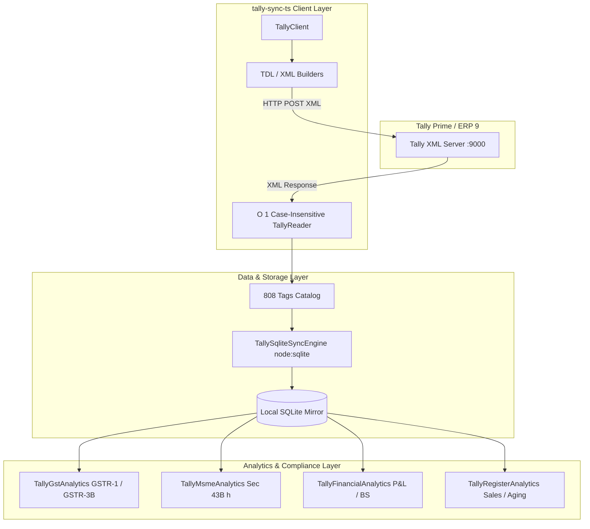

# tally-sync-ts

[](https://www.npmjs.com/package/tally-sync-ts) [](#license)

A typed TypeScript client and **synchronisation engine for TallyPrime and Tally ERP 9**, built for software that has to put real invoices into a real company file and be sure of what happened.

It talks to Tally's XML gateway, but it does not assume anything about *your* Tally: it **discovers the company's own ledgers, tax layout, godown and batch habits**, posts **idempotently** (a retry can never create a second voucher), **reads every voucher back**, and protects a single-threaded Tally from the traffic that normally hangs it.

```bash
npm install tally-sync-ts
```

> **Need the whole product, not just the library?** See [Full solutions & custom builds](#full-solutions--custom-builds) at the end: ShopControl (billing + stock + GST app, web, mobile, WhatsApp) with a ready Tally synchroniser, or a custom build for your business.

## What it does

| | |
|---|---|
| **Post sales invoices safely** | Integer-paise GST maths (inclusive and exclusive, per-slab or per-line rounding), a balance check before anything is sent, GUID-based idempotency, read-back verification, classified failures (`TRANSIENT` vs `PERMANENT`). |
| **Learn the company, don't hardcode it** | `discoverCompanyProfile` classifies ledgers by *group ancestry and GST duty head* (never by name); `learnVoucherBlueprint` and `resolveInvoiceContext` learn which sales, tax and round-off ledgers, godown and batch the company really uses from its own vouchers, and ask the owner when it cannot decide. |
| **Protect Tally** | `TallyGate`: one request in flight, writes before reads, measured timeouts, circuit breaker, light health probe. Never sends the wildcard fetch that hangs Tally. |
| **Detect changes cheaply** | AlterID/month-window voucher index and diff, instead of re-reading the company. |
| **Find the data folder** | `findTallyDataPaths` locates company folders on any drive (C:, D:, E:, removable), from Tally's own config and logs, without ever opening data files. |
| **Survive failure** | Durable `JobQueue` with leases and fencing (a crash mid-post is *verified*, never blindly retried), `CircuitBreaker`, backoff with jitter, `SseParser`, `ResourceGuard`, signed rule packs, adaptive timeouts and batch sizes. |
| **Mirror and report** | Zero-dependency SQLite mirror (`node:sqlite`) of masters and vouchers; GSTR-1, GSTR-3B, MSME 43B(h), P&L, Balance Sheet, registers, ageing. |
| **Typed** | 808 Tally XML tags as TypeScript types, Zod schemas, no `any` in the public model. |

## Verified, and what is not

Developed against **TallyPrime 7.1** with a real company: profile discovery, ledger-role classification, blueprint learning from ~300 live vouchers, data-path discovery, voucher index and capability detection were run read-only against it. Everything else (the import paths, alteration, cancellation, Auto Renumber with an omitted number, e-invoice) is covered by unit tests against a fake Tally and should be validated on an **isolated test company** before you trust it with a live one. The library never writes unless you call a posting function, and the test suite never touches a real company.

---

## Key Features

- **808 Strongly Typed Tally XML Tags**:
  - Full bidirectional type safety across Ledgers, Vouchers, Stock Items, Companies, and Reports.
  - Dedicated typed interfaces for sub-allocations (`BillAllocationTag[]`, `BankAllocationTag[]`, `BatchAllocationTag[]`, `AddressLineTag[]`, `GstRateDetailTag[]`, `InventoryEntryTag[]`, etc.).
  - Zero `Record<string, unknown>` and zero `any` in the type system.
- **Zero-Dependency Native SQLite Mirror Engine (`node:sqlite`)**:
  - High-speed relational database mirror for offline analytical queries and instant reporting.
  - Synchronizes an entire company (companies, groups, ledgers, stock items, vouchers, line items, bill allocations) in milliseconds inside an atomic transaction.
  - Full fidelity: preserves all 808 tags in indexed `raw_tags JSON` columns for custom SQL queries via `json_extract()`.
- **Statutory GST Analytics Suite**:
  - **GSTR-1 Table 4 (B2B Invoices)**: Registered party sales, intra/inter-state tax breakdown (CGST, SGST, IGST), and Place of Supply.
  - **GSTR-1 Table 12 (HSN Summary)**: Aggregated HSN, description, UQC, total quantity, taxable value, and tax rates.
  - **GSTR-3B Tax Summary**: Real outward taxable supply and tax liability calculation derived directly from voucher ledger entries.
  - Native Tally **GST Computation** XML report parser.
- **MSME Section 43B(h) Compliance Engine**:
  - **Creditor Classification**: Categorizes Sundry Creditors into Micro, Small, Medium, or Non-MSME, capturing Udyam Registration Numbers.
  - **Overdue Audit**: Tracks unpaid bills against statutory 15-day (no agreement) and 45-day (with agreement) limits under Section 15 of the MSMED Act.
  - **Tax Disallowance Risk Flag**: Highlights overdue invoices subject to tax disallowance under Section 43B(h) of the Income Tax Act.
  - **Section 16 Compound Interest Calculator**: Automatically computes penal interest at 3 times the RBI Bank Rate compounded monthly.
- **ERP Financial Statements & Operational Registers**:
  - **Profit & Loss**: Gross profit, Cost of Goods Sold, Incomes, Expenses, and Net profit mapped to Tally's 28 standard primary groups.
  - **Balance Sheet**: Capital & Liabilities vs Fixed Assets, Current Assets, and Closing Stock.
  - **Sales Register**: Invoice-by-invoice breakdown of gross values, item rates, discounts, HSN codes, and GST breakdown.
  - **Financial Ratios**: Working Capital, Current Ratio, Quick Ratio, and Days Sales Outstanding (DSO).
  - **Aging Analysis**: Debtors & Creditors aging categorized into standard buckets (`0–30`, `31–60`, `61–90`, and `> 90 days`).
- **Bidirectional CRUD Operations**:
  - Create, Alter, Delete, and Cancel actions for vouchers and masters.
  - Item Invoice, Accounting Invoice, and Journal modes with multi-currency and round-off support.
- **Runtime Validation**:
  - Complete Zod schemas matching all models (`VoucherSchema`, `LedgerSchema`, `StockItemSchema`, `CompanySchema`, etc.).

---

## Architecture



---

## Requirements

- **Node.js**: v22.0.0 or higher (supports native `node:sqlite`).
- **Tally**: TallyPrime (developed on 7.1; the release is detected from the reply header) or Tally ERP 9, with the XML gateway enabled (default port 9000). Run the agent on the Tally PC: the gateway is single-threaded and should not be shared across a network.

---

## Installation

```bash
npm install tally-sync-ts
```

Or clone for development:

```bash
git clone https://github.com/GreenHacker420/tally-sync-ts.git
cd tally-sync-ts
npm install
npm run build
```

---

## Quick Start

### 1. Connect and Fetch Masters

```typescript
import { TallyClient } from "tally-sync-ts";

const client = new TallyClient({
  host: "http://localhost",
  port: 9000,
  company: "ACME INDUSTRIES LTD"
});

// Check connectivity
const isConnected = await client.check();
console.log("Connected to Tally:", isConnected);

// Fetch Ledgers with live balances
const ledgers = await client.getObjects("Ledger");
for (const l of ledgers) {
  console.log(`${l.name} | Group: ${l.parent} | Balance: ₹${l.closingBalance}`);
}

// Fetch Stock Items with unit valuations
const stockItems = await client.getObjects("StockItem");
for (const item of stockItems) {
  console.log(`${item.name} | Qty: ${item.closingBalance?.value} ${item.baseUnit} | Value: ₹${item.closingValue?.value}`);
}
```

---

### 2. High-Speed SQLite Mirroring

Mirror all masters and vouchers to an in-memory or persistent SQLite database in milliseconds:

```typescript
import { DatabaseSync } from "node:sqlite";
import { TallyClient, TallySqliteSyncEngine } from "tally-sync-ts";

const client = new TallyClient({ host: "http://localhost", port: 9000, company: "ACME INDUSTRIES LTD" });
const db = new DatabaseSync("tally_mirror.sqlite");
const engine = new TallySqliteSyncEngine(db);

// Pull live data
const [companies, groups, ledgers, stockItems, vouchers] = await Promise.all([
  client.getObjects("Company"),
  client.getObjects("Group"),
  client.getObjects("Ledger"),
  client.getObjects("StockItem"),
  client.getObjects("Voucher", { fromDate: "20250401", toDate: "20260331" })
]);

// Sync atomically
const stats = engine.syncAll({ companies, groups, ledgers, stockItems, vouchers });
console.log(`Synced in ${stats.durationMs}ms:`, stats);

// Execute instant direct SQL queries
const topCustomers = engine.query(`
  SELECT party_ledger_name, COUNT(*) as invoice_count, SUM(amount) as total_revenue
  FROM tally_vouchers
  WHERE voucher_type = 'Sales'
  GROUP BY party_ledger_name
  ORDER BY total_revenue DESC
  LIMIT 5
`);
console.table(topCustomers);
```

---

### 3. Statutory GST Returns (GSTR-1 & GSTR-3B)

Generate filing-grade GST reports derived directly from actual voucher entries and tax ledgers:

```typescript
import { TallyGstAnalytics } from "tally-sync-ts";

const gst = new TallyGstAnalytics(engine);

// 1. GSTR-1 Table 4: B2B Invoices
const b2bInvoices = gst.getGstr1B2B({
  fromDate: "20250401",
  toDate: "20250430"
});
console.table(b2bInvoices);

// 2. GSTR-1 Table 12: HSN Summary
const hsnSummary = gst.getGstr1HsnSummary();
console.table(hsnSummary);

// 3. GSTR-3B Monthly Tax Liability
const gstr3b = gst.getGstr3bSummary();
console.log("Taxable Value : ₹", gstr3b.outwardTaxableSupplies.taxableValue);
console.log("Central Tax   : ₹", gstr3b.outwardTaxableSupplies.cgst);
console.log("State Tax     : ₹", gstr3b.outwardTaxableSupplies.sgst);
console.log("Integrated Tax: ₹", gstr3b.outwardTaxableSupplies.igst);
```

---

### 4. MSME Compliance & Section 43B(h) Reporting

Audit Sundry Creditors against Section 15 & 16 of the MSMED Act and Section 43B(h) of the Income Tax Act:

```typescript
import { TallyMsmeAnalytics } from "tally-sync-ts";

const msme = new TallyMsmeAnalytics(engine);

// 1. Supplier classification (Micro, Small, Medium, Non-MSME)
const suppliers = msme.getMsmeSuppliersSummary();
console.table(suppliers);

// 2. Section 43B(h) Overdue Audit (15/45 days limit)
const overdueBills = msme.getMsme43bOverdueReport({
  asOfDate: "2025-03-31",      // Fiscal year-end cutoff
  customAgreementDays: 45      // Statutory maximum limit
});

for (const bill of overdueBills) {
  if (bill.section43bDisallowanceRisk) {
    console.warn(`⚠️ High Tax Disallowance Risk: Bill ${bill.billNumber} from ${bill.supplierName} (${bill.enterpriseType}) is overdue by ${bill.daysOverdue} days.`);
    console.log(`   Pending Amount: ₹${bill.outstandingAmount} | Penal Interest Liable: ₹${bill.penalInterestLiable}`);
  }
}
```

---

### 5. Financial Statements & Operational Registers

```typescript
import { TallyFinancialAnalytics, TallyRegisterAnalytics } from "tally-sync-ts";

const fin = new TallyFinancialAnalytics(engine);
const reg = new TallyRegisterAnalytics(engine);

// Profit & Loss Statement (Mapped to Tally's 28 Primary Groups)
const pl = fin.getProfitAndLoss();
console.log(`Gross Profit: ₹${pl.grossProfit} | Net Profit: ₹${pl.netProfit}`);

// Balance Sheet
const bs = fin.getBalanceSheet();
console.log(`Total Assets: ₹${bs.applicationOfFunds.total}`);

// Sales Register with exact gross and tax splits
const salesRegister = reg.getSalesRegister();
console.table(salesRegister.slice(0, 10));

// Financial Ratios & DSO
const ratios = reg.getRatioAnalysis();
console.log(`Working Capital: ₹${ratios.workingCapital}`);
console.log(`Current Ratio  : ${ratios.currentRatio}`);
console.log(`Quick Ratio    : ${ratios.quickRatio}`);
console.log(`Debtors DSO    : ${ratios.debtorsTurnoverDays} days`);

// Aging Analysis (0-30, 31-60, 61-90, 90+ days)
const debtorsAging = reg.getAgingAnalysis("receivables");
console.table(debtorsAging);
```

---

### 6. Accessing the 808 Tally XML Tags

Every parsed entity implements `TallyTaggedEntity` and provides full autocompletion across all 808 cataloged XML tags:

```typescript
import type { TallyAllTagsRecord } from "tally-sync-ts";

// First-class normalized properties
console.log(voucher.voucherNumber);
console.log(voucher.date);
console.log(voucher.partyName);

// Direct strongly-typed access to any of the 808 tags:
console.log(voucher.tags.BASICBUYERNAME);
console.log(voucher.tags.DISPATCHDOCNO);
console.log(voucher.tags.IRN);

// Deep Ledger tags:
console.log(ledger.tags.BANKCONFIGIFSC);
console.log(ledger.tags.MSMEREGNUMBER);
console.log(ledger.tags.CREDITLIMIT);

// Universal helper methods:
const buyerGstin = voucher.getString("PARTYGSTIN");
const billList = voucher.getList("BILLALLOCATIONS.LIST");
```

---

### 7. Posting a Sales Invoice (recommended flow)

```typescript
import {
  TallyClient, TallyGate, FetchTallyTransport, CompanyContextLearner,
  withInvoiceContext, loadMasterCatalog, planSalesInvoiceMasters, postSalesInvoice, PostState, TaxMode,
} from "tally-sync-ts";

// One gate in front of every request: single flight, priorities, timeout, circuit breaker.
const gate = new TallyGate(new FetchTallyTransport({ baseURL: "http://127.0.0.1", port: 9000 }), { timeoutMs: 30_000 });
const client = new TallyClient({ transport: gate });

// 1. Learn the company (cheap masters every call; the heavy voucher sample only when masters change).
const learner = new CompanyContextLearner(client, { companyName: "ACME TRADERS" });
const learned = await learner.resolve();
if (!learned.context) {
  // e.g. two sales ledgers and no history to decide: ask the owner, never guess.
  console.log("Owner input needed:", learned.questions);
  process.exit(0);
}
console.log(learned.provenance); // { sales: 'SALES A/C (296/296 vouchers)', 'tax.cgst': 'CGST (294/296 ...)', ... }

// 2. Business facts only. Ledgers, state, godown and batch come from the context.
const input = withInvoiceContext(learned.context, {
  idempotencyKey: "sale_8f2c",          // becomes the voucher GUID: replaying is safe
  date: "20261118",
  reference: "INV-0042",
  party: { name: "DEMO CUSTOMER CORP", gstin: "27ABCDE1234F1Z5" },
  placeOfSupply: "Maharashtra",
  taxMode: TaxMode.EXCLUSIVE,
  lines: [{ itemName: "INDUSTRIAL CABLE", quantity: "100", unit: "PCS", amountPaise: 5_000_000,
            gst: { taxability: "Taxable", basisPoints: { cgst: 900, sgst: 900, igst: 1800, cess: 0 } } }],
});

// 3. Pre-flight: nothing is created silently. Missing customer/item/ledger? Report it.
const catalog = await loadMasterCatalog(client, learned.context.companyState);
const plan = planSalesInvoiceMasters(input, catalog);
if (!plan.ready) console.log("Missing in Tally:", plan.missing);

// 4. Post: GUID pre-check, import, classify, read back and verify.
const outcome = await postSalesInvoice(client, { ...input, party: { ...input.party, isBillWise: plan.partyIsBillWise } }, { company: "ACME TRADERS" });
switch (outcome.state) {
  case PostState.CONFIRMED: console.log("Posted", outcome.voucherNumber, outcome.alreadyPosted ? "(was already there)" : ""); break;
  case PostState.MISMATCH: console.log("Posted but Tally holds a different amount"); break;       // never auto-adjusted
  case PostState.POSTED_UNVERIFIED: console.log("Accepted, read-back failed: verify later"); break;
  default: console.log("Failed:", outcome.failure);                                               // typed, classified
}
```

The low-level `client.postObjects("Voucher", [...])` is still available for custom vouchers, but it does **not** give you idempotency, balance checks or read-back.

---

## Resilience toolkit

For long-running agents (an Electron app on the shop's Tally PC, a service) the package ships the pieces that keep them correct when things fail:

- **`JobQueue`** (SQLite): leases with fencing tokens; a worker that crashes mid-post leaves the job `VERIFYING`, so the next worker checks Tally for the voucher's GUID *before* posting again; bounded retries with backoff and a dead letter; "waiting for a customer to exist" does not burn the retry budget; stale workers cannot overwrite newer state.
- **`CircuitBreaker`**: rolling window, single recovery probe, counts only availability failures (a 400 does not take your cloud offline).
- **`SseParser`**: Server-Sent-Events parsing that survives events split across TCP chunks, with a bounded buffer.
- **`ResourceGuard`**: heap, disk and event-loop pressure decide when to shed background extraction (posting is never shed).
- **Policy registry** (`resolvePolicy`, `explainPolicy`): every tunable is declared once with bounds; layered values (default, shop, company...) with provenance of who set what. `policyRegistryJson()` exports it for services that cannot import the package.
- **Rule packs** (`compileRulePack`, `signPack`, `loadSignedPack`, `QuarantineLog`): Tally error classification as validated, ed25519-signed, rollback-proof *data*; unknown messages are quarantined for labelling, not dropped.
- **Adaptive control** (`LatencyTracker`, `adaptiveTimeoutMs`, `AimdBatch`, `retryDelayMs`).

## Safety rules the library enforces

1. No silent master creation: a missing customer, item or ledger is reported, never invented.
2. No hardcoded company facts: ledger names, state, godown, batch, voucher type and duty-head spellings come from the company or from a dialect data file. A test fails the build if one appears in engine code.
3. Money is integer paise; no floating point in tax or totals.
4. A voucher that does not balance is refused before it is sent.
5. A retry after an ambiguous outcome checks the original identity first.
6. A wildcard `FETCH *` is never sent to Company (it has hung a live TallyPrime).

---

## Running Tests

The suite has ~290 automated tests: XML parsing and serialisation, the 808 tags, SQLite mirroring, GST/MSME accuracy, tax and balance invariants (including randomised company layouts), the job queue's crash recovery, breakers and parsers. Live, read-only checks against a real Tally are skipped unless you opt in:

```bash
npm test
TALLY_LIVE_URL=http://127.0.0.1:9000 npm run test:live   # read-only; never writes
```

---

## Full solutions & custom builds

`tally-sync-ts` is one part of a larger product. If you want the finished system rather than building it yourself, get in touch:

- **ShopControl**: billing, stock and GST for shops and distributors, with a **mobile app, web app and WhatsApp** (invoices, payment reminders, order intake), and a **ready-made Tally desktop synchroniser** built on this library (two-way sync, voucher numbers shown side by side, owner approvals, audit trail).
- **Integration**: connect Tally to your own software, ERP, e-commerce or WhatsApp flows.
- **Custom builds**: dashboards, reports, mobile and web apps, automation and anything else your business needs, designed around how you actually work.

**Contact:** open a conversation with the author on GitHub, [@GreenHacker420](https://github.com/GreenHacker420) (issues and discussions on this repository are read too: <https://github.com/GreenHacker420/tally-sync-ts/issues>). Mention "ShopControl" or "custom build" and a rough description of what you need.

---

## License

MIT © GreenHacker420 (Harsh Hirawat)
